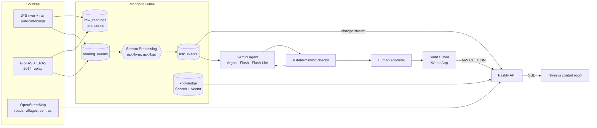

# MonsoonWatch

A 3D early-warning control room for monsoon floods and landslides, demoed on the Kelantan valley in Malaysia during the December 2014 floods.

River and rain readings stream into MongoDB. Risk is detected as the data arrives. A Gemini agent turns the risk into an alert for each village at risk, with the nearest usable relief centre, a dry road route (or "boat only"), and a message in Malay and English. Deterministic checks verify every alert. A human approves it before anything is sent. Saint's agent, Thea, then coordinates the follow-up with the village head on WhatsApp and reports headcounts back.

All code in this repository was written during Encode London 2026.

> **Videos:** Video A (demo) · Video B (Gemini) · Video C (Saint) — _links added at submission_

## What you see

- **Control room** ([`apps/web`](apps/web)): a Three.js model of the Kelantan valley. It shows river stations, rain, flood extent, landslide-prone slopes, villages, relief centres and the road network. Roads cut by water turn red.
- **The 2014 replay:** 18 Dec 2014 → 10 Jan 2015, played back as live events. On 24 Dec the road from Kampung Wakaf Bata to its relief centre floods. The agent's first route fails the route check, it replans, and the 10.3 km detour passes.
- **Alerts panel:** each alert shows its six checks (red ticks turn green as the agent replans), the people to pick up, and the Approve button.
- **Tech HUD:** every step of the pipeline (Stream Processing event, change stream, Gemini call, check, approval, Saint check-in) appears as it happens.
- **Resident page:** the approved alert as a resident sees it, in Malay and English, with a read-aloud button.

## Architecture



| Path | What |
|---|---|
| [`apps/web`](apps/web) | Vite + Three.js control room and resident page |
| [`apps/api`](apps/api) | Fastify API: data, hazards model, live events (SSE), agent, alerts, Saint |
| [`packages/shared`](packages/shared) | Shared types, API contract and live event names |
| [`scripts`](scripts) | Data loaders: JPS, 2014 replay, OSM, terrain, places, knowledge |
| [`docs`](docs) | Design docs: [guidelines](docs/GUIDELINES.md), [implementation plan](docs/IMPLEMENTATION.md), [hazards model](docs/HAZARDS.md), [vulnerable residents](docs/VULNERABLE.md), [Saint brief](docs/saint-brief.md) |

## How we use Gemini

The agent run is in [`orchestrator.ts`](apps/api/src/agent/orchestrator.ts). Every village at risk ends with an alert, and nothing is sent without approval.

1. **Risk screen** ([`shortlist.ts`](apps/api/src/agent/shortlist.ts)): fixed rules put all 765 villages into at risk, watch, unknown or no signal.
2. **Gemini 4 Argon does the judgement** ([`gemini-planners.ts`](apps/api/src/agent/gemini-planners.ts), prompt [`orchestrator.md`](apps/api/src/agent/prompts/orchestrator.md)). In one ≈38k-token context it reads the most at-risk villages, every advisory village, the readings and all 40 documents (2014 reports, Deep Research). It ranks the at-risk villages with ETAs and cited evidence. It **escalates** advisory villages the rules under-rate, and code checks each claim ([`escalation.ts`](apps/api/src/agent/escalation.ts)): the gauge must support the level and quotes must be verbatim. It can raise the alarm but never lower it. It also writes the situation report for officials.
3. **Rules planner** ([`rules-planner.ts`](apps/api/src/agent/rules-planner.ts)): code, not an LLM, plans every village. It picks the nearest usable centre by dry road (else by boat), books capacity across villages and lists pickups.
4. **Gemini per village**: Gemini plans the villages the rules couldn't plan, plus the top five for tailored messages. Attempt 1 is a quick Flash-Lite draft. Attempts 2–4 use Flash with function calling (`list_evac_centres`, `plan_route`, `suggest_pickups`, `submit_plan`; [`tool-loop.ts`](apps/api/src/agent/tool-loop.ts), [`route.ts`](apps/api/src/agent/route.ts)), and each attempt is given the reasons the last one failed.
5. **Verification** ([`verify.ts`](apps/api/src/agent/verify.ts), [`vulnerable.ts`](apps/api/src/agent/vulnerable.ts)): six deterministic checks with no LLM: threshold, route, capacity (including the village split across centres), data freshness, language (each message starts with its level word) and vulnerable-people pickups. A failure feeds the replan prompt.
6. **Nobody left out** ([`coverage.ts`](apps/api/src/agent/coverage.ts)): at-risk villages with no verified plan get a district evacuate warning, and watch or unknown villages get a district advisory. Both are templates, and an official approves them like alerts (`/api/area-warnings`).
7. **Spoken alerts** ([`speech.ts`](apps/api/src/agent/speech.ts)): Gemini TTS generates audio of the approved alert in Malay and English (`GET /api/alerts/:id/audio/:lang`). The resident page currently uses the browser's own speech.
8. **Landslide thresholds from Gemini Deep Research** ([`research/`](apps/api/src/agent/research)): Deep Research collected published rainfall thresholds for Kelantan. The committed result ([`landslide-thresholds.kelantan.json`](apps/api/src/agent/research/output/landslide-thresholds.kelantan.json)) drives the landslide screen ([`landslide.ts`](apps/api/src/agent/landslide.ts)), and the report is saved to the `knowledge` collection for search.

Calls go through the Interactions API ([`gemini.ts`](apps/api/src/agent/gemini.ts)); model IDs are in [`models.ts`](apps/api/src/agent/models.ts).

## How we use MongoDB Atlas

| Feature | Where | What for |
|---|---|---|
| **Time series collection** | `raw_readings` ([`setup.ts`](apps/api/src/db/setup.ts)) | Every river and rain reading |
| **Atlas Stream Processing** | [`risk.js`](apps/api/src/db/stream-processors/risk.js), [`stream.ts`](apps/api/src/db/stream.ts) | Processors `riskRiver` and `riskRain` compare each reading with its thresholds and write `risk_events`. A plain `reading_events` collection (TTL 7 days) feeds them, because time series collections can't be a change stream source. |
| **Change streams** | [`change-streams.ts`](apps/api/src/events/change-streams.ts) | New readings, risk events, alerts and Saint updates are pushed to the browser over SSE (`/api/stream`). |
| **Geospatial (2dsphere)** | villages, centres, roads, stations | Nearest centres, villages near a station, flood-extent lookups |
| **Atlas Search** | [`places.ts`](apps/api/src/search/places.ts) | Typo-tolerant search over village and centre names (`GET /api/search?type=place`) |
| **Vector Search + automated embedding** (Voyage `voyage-4`) | [`knowledge.ts`](apps/api/src/search/knowledge.ts), [indexes](apps/api/src/db/indexes) | Search over 22 sourced passages about the 2014 floods ([`kelantan-2014.csv`](scripts/data/knowledge/kelantan-2014.csv)) and the Deep Research report, in English and Malay |
| **Hybrid search (`$rankFusion`) + native `$rerank`** (`rerank-2.5`) | [`knowledge.ts`](apps/api/src/search/knowledge.ts) | Text and vector results fused, then reranked (`GET /api/search?type=hybrid`) |

Set up with `pnpm db:setup` (collections and indexes) and `pnpm db:stream` (processors).

## How we use Saint

Saint's agent, Thea, is the human coordinator after an alert is approved. Thea works on WhatsApp with cleared contacts. In our demo the cleared contact is the ketua kampung (village head) of Kampung Manik Urai.

1. An official approves an alert. The **Send to Saint** button ([`saint.ts`](apps/web/src/ui/saint.ts)) opens a brief for Thea ([`brief.ts`](apps/api/src/saint/brief.ts)): the village, the centre, the route, the people to pick up, and the exact reply format.
2. Thea messages the village head and coordinates the move.
3. Thea reports back with lines like `MW CHECKIN alert=… centre=… people=12 status=arrived`. These are pasted into the control room (`POST /api/saint/updates`, parser in [`checkin.ts`](apps/api/src/saint/checkin.ts)). Each line updates the centre headcount and appears on the HUD. Repeated lines are ignored.

Routes: [`routes/saint.ts`](apps/api/src/routes/saint.ts). Brief and log: [`docs/saint-brief.md`](docs/saint-brief.md), [`docs/saint-log.md`](docs/saint-log.md).

## Data sources

| Data | Source | Notes |
|---|---|---|
| River levels and rainfall (live) | JPS Malaysia, [publicinfobanjir.water.gov.my](https://publicinfobanjir.water.gov.my) | Loader: [`ingest-jps.ts`](scripts/ingest-jps.ts) |
| River discharge, Dec 2014 | GloFAS via the [Open-Meteo Flood API](https://open-meteo.com/en/docs/flood-api) | Converted to river levels with a curve calibrated to JPS's published 2014 peaks ([source](https://cgss.usm.my/images/Air_-_Prof._Ir._Mohd_Nordin_Adlan.pdf)) |
| Rainfall, Dec 2014 | ERA5 via the [Open-Meteo Archive API](https://open-meteo.com/en/docs/historical-weather-api) | Loader: [`load-replay-2014.ts`](scripts/load-replay-2014.ts) |
| Villages, roads, schools, relief centres | [OpenStreetMap](https://www.openstreetmap.org/copyright) via Overpass | © OpenStreetMap contributors, ODbL |
| Terrain | [Terrarium elevation tiles](https://registry.opendata.aws/terrain-tiles/), [Open-Meteo Elevation API](https://open-meteo.com/en/docs/elevation-api) | 3D scene and road heights |
| Vulnerable-resident rates | DOSM and JKM figures ([`rates.json`](scripts/data/vulnerable/rates.json)) | See [VULNERABLE.md](docs/VULNERABLE.md) |
| Knowledge passages | 22 passages, each with its source URL | [`kelantan-2014.csv`](scripts/data/knowledge/kelantan-2014.csv) |

## Limits (please read)

- **This is a prototype, not an operational warning system.** Real warnings in Malaysia come from JPS, MetMalaysia and NADMA.
- **The demo runs on the 2014 replay, not live data.** The JPS site's TLS certificate had expired, and on 24 Oct 2026 the site moved its pages and changed its station IDs. The live loader is kept in the repo but was not running for the demo.
- **The 2014 river levels are estimates.** They are reconstructed from GloFAS model discharge, and the UI labels the replay "Reconstructed 2014 replay".
- **The flood extent and road status are approximations** from terrain height and the estimated river level ([HAZARDS.md](docs/HAZARDS.md)). Roads outside the modelled floodplain show as "unknown", not "clear".
- **The landslide layer is a screening tool.** It flags slopes worth checking from rainfall thresholds and slope; it does not predict slides.
- **Vulnerable-resident counts are estimates** from district rates, except two demo villages with scripted values ([VULNERABLE.md](docs/VULNERABLE.md)).
- **No alert is sent automatically.** Every alert waits for a human. The public demo is read-only.

## Run it

Needs Node 20.19+ (or 22.12+) and pnpm (`corepack enable`).

```bash
pnpm install
cp .env.example .env   # add keys; not needed for mock mode
pnpm dev:mock          # fixtures and scripted live events, no keys needed
pnpm dev               # real services (MongoDB Atlas, Gemini)
pnpm typecheck
```

Web: http://localhost:5173 · API: http://localhost:8787/api/health

**With your own Atlas cluster** (M10 or above for Stream Processing and automated embedding):

```bash
pnpm db:setup          # collections and indexes
pnpm seed:region       # Kelantan region, stations and thresholds
pnpm load:osm          # villages, roads, centres (replaces existing data)
pnpm load:places && pnpm load:vulnerable && pnpm load:knowledge
pnpm build:terrain && pnpm prep:hazards
pnpm load:replay       # Dec 2014 replay data
pnpm db:stream         # start the Stream Processing processors (billed per hour)
```

Play the replay: `POST /api/replay/start {"regionId":"kelantan","from":"2014-12-18"}`, then `GET /api/replay/status` and `POST /api/replay/stop`. Stop the processors afterwards with `pnpm db:stream --stop`.

## Team

Built at Encode London 2026 by Umaira (frontend, 3D scene), Tisha (Gemini agent and alerts) and Heru (data, MongoDB and Saint).
